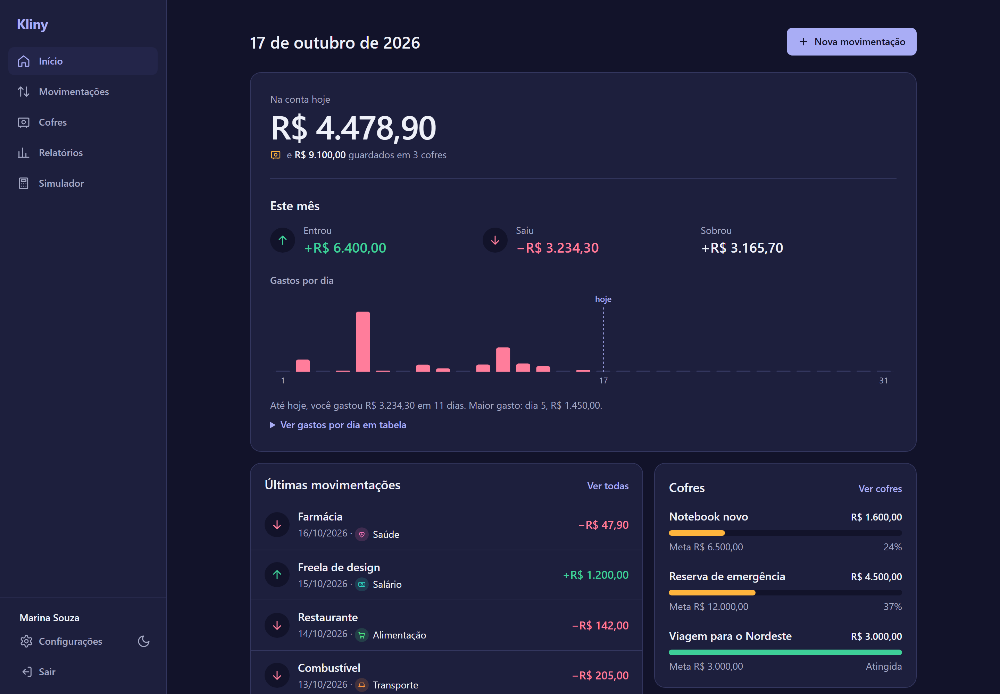
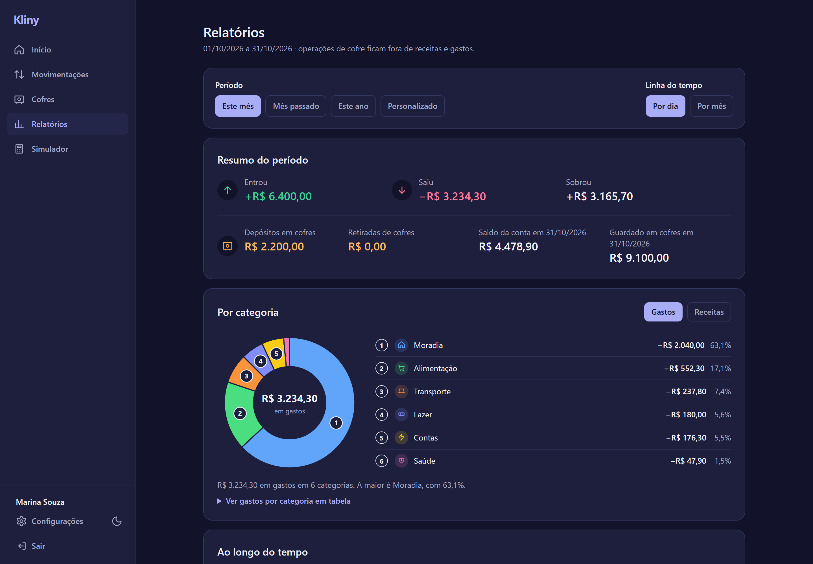
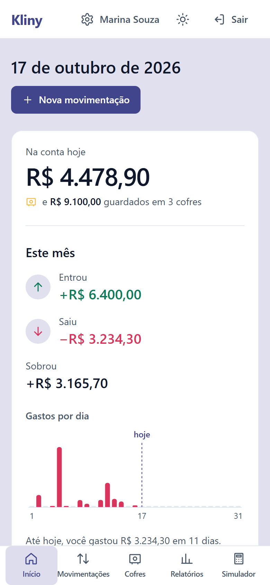
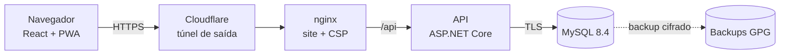

<div align="center">


<h1>Kliny</h1>

<p><strong>Guarde seu dinheiro como um hamster guarda sementes.</strong></p>

<p>Controle financeiro pessoal na web: receitas e gastos, cofres com meta, orçamento por categoria,<br/>
recorrentes e parcelados, importação de extrato e relatórios. Seus dados ficam só com você.</p>

<p>🌐 <strong><a href="https://kliny.app.br">kliny.app.br</a></strong> — no ar</p>

<p>
  
  
  
  
  
  
</p>

<p>
  <a href="https://github.com/YlkersonDias/kliny/actions/workflows/ci.yml"></a>
  
  
  
  <a href="LICENSE"></a>
</p>

<p>
  <a href="#-funcionalidades">Funcionalidades</a> ·
  <a href="#-seguran%C3%A7a">Segurança</a> ·
  <a href="#%EF%B8%8F-arquitetura">Arquitetura</a> ·
  <a href="#-como-rodar">Como rodar</a>
</p>

</div>

<br/>



<table>
  <tr>
    <td></td>
    <td></td>
  </tr>
</table>

## ✨ Funcionalidades

- 💸 **Receitas e gastos** com categorias de cor e ícone, busca e filtros
- 🐹 **Cofres** para guardar dinheiro, com meta e extrato próprio
- 🎯 **Orçamento por categoria**, com aviso quando passa do limite
- 🔁 **Recorrentes e parcelados**: aluguel, salário e compras em várias vezes
- 📥 **Importação de extrato** (OFX e CSV) sem duplicar, lida só no navegador
- 📊 **Relatórios** com gráficos por categoria e ao longo do tempo
- 📈 **Simulador de aportes** com juros compostos
- 🌙 Modo escuro, português e inglês, e instalável no celular

## 🔒 Segurança

O Kliny guarda dados financeiros de pessoas reais, então a segurança vem antes de tudo.

| Camada | Como |
|---|---|
| **Dados isolados** | Toda consulta é filtrada pelo dono, com uma segunda camada no banco. Testes no CI conferem, endpoint por endpoint, que uma pessoa não acessa os dados de outra. |
| **Contas** | Senhas com BCrypt, sessão de 60 minutos com "sair de todos os dispositivos", limite de tentativas e respostas que não revelam se um e-mail tem conta. |
| **Dinheiro** | Depósitos e retiradas idempotentes e travados contra concorrência: um clique repetido nunca vira dois lançamentos. |
| **Navegador** | CSP sem `unsafe-inline` e nada da API guardado no navegador. |
| **Servidor** | Usuário do banco só com leitura e escrita, sem portas abertas na máquina e backups cifrados. |
| **Código** | Varredura de segredos no histórico inteiro, actions fixadas por SHA e Dependabot. |

Encontrou uma falha? Veja o [SECURITY.md](SECURITY.md) para relatar em privado.

## 🏗️ Arquitetura



Tudo roda em containers Docker. Nenhuma porta fica aberta na máquina: o único caminho de fora é o túnel da Cloudflare, uma conexão de saída. O site e a API ficam na mesma origem, sem CORS.

## 🚀 Como rodar

Com o Docker, no PowerShell, dentro da pasta `deploy`:

```powershell
powershell -ExecutionPolicy Bypass -File .\criar-segredos.ps1
docker compose --profile migrate build
docker compose --profile migrate run --rm migrate
docker compose -f docker-compose.yml -f docker-compose.local.yml up -d --build
```

O site abre em `http://localhost:8080`. O `criar-segredos.ps1` gera o `deploy/.env` com senhas aleatórias (fora do Git). Sem a chave do [Resend](https://resend.com) no `.env`, nenhum e-mail é enviado, e o cadastro, que confirma o e-mail por link, não termina. O passo a passo completo, com o túnel da Cloudflare e os backups, está no [deploy/README.md](deploy/README.md).

<details>
<summary><strong>Desenvolvimento</strong></summary>

- **Frontend** (`frontend`): `npm ci` e `npm run dev`. O Vite repassa `/api` para `http://localhost:5228`.
- **Backend** (projeto `Kliny.Api`, na pasta `backend`): a conexão com o MySQL e a chave do JWT ficam no user-secrets (`ConnectionStrings:DefaultConnection` e `Jwt:Key`, com pelo menos 32 caracteres); depois, `dotnet run`.
- **Testes:** `npm test` no frontend e `dotnet test --solution Kliny.sln` na raiz. Os testes com MySQL precisam da variável `KLINY_TEST_MYSQL`; o `scripts/backend-tests-docker.sh` sobe um MySQL descartável e roda tudo num container, como no CI.

</details>

## 📄 Licença

Código sob a [AGPL-3.0](LICENSE): você pode usar, estudar, modificar e redistribuir, e quem colocar uma versão modificada no ar como serviço precisa publicar o código dela sob a mesma licença.

O nome **Kliny** e o mascote (o hamster, em `frontend/public/mascote/`) não estão incluídos na licença: num fork, use outro nome e outras imagens. A fonte Bricolage Grotesque segue a própria licença (SIL OFL 1.1, em `frontend/public/licencas/`).
